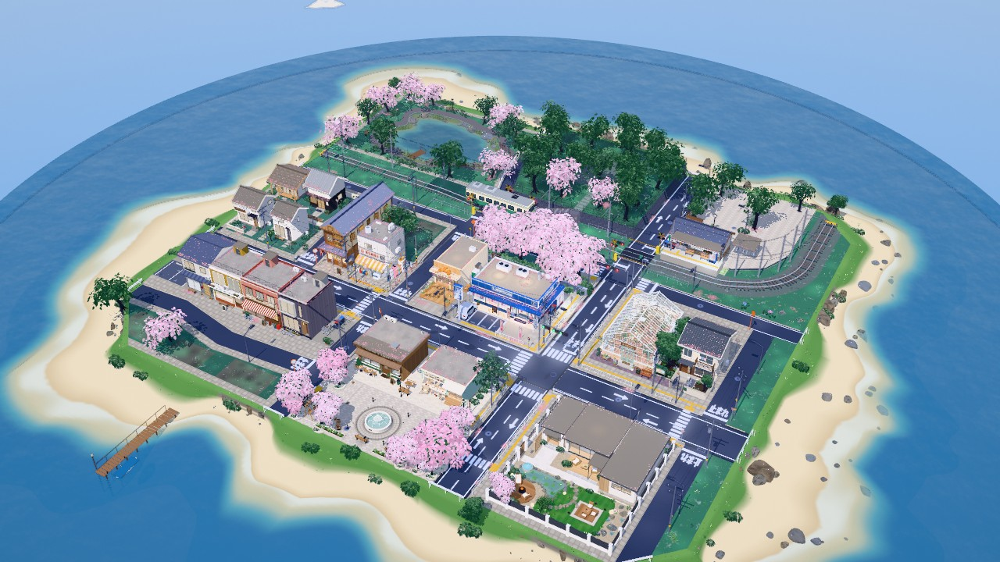
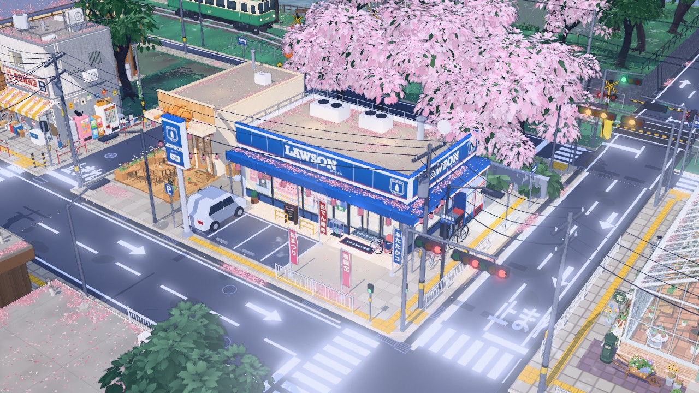
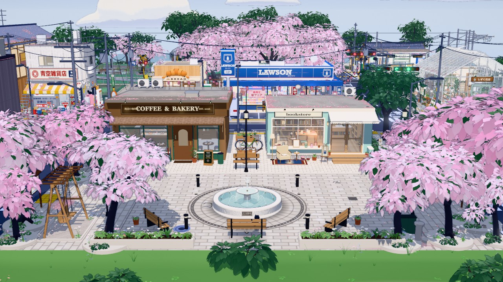
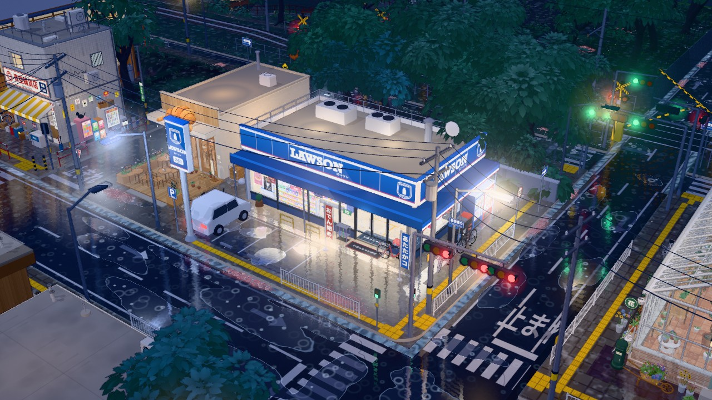
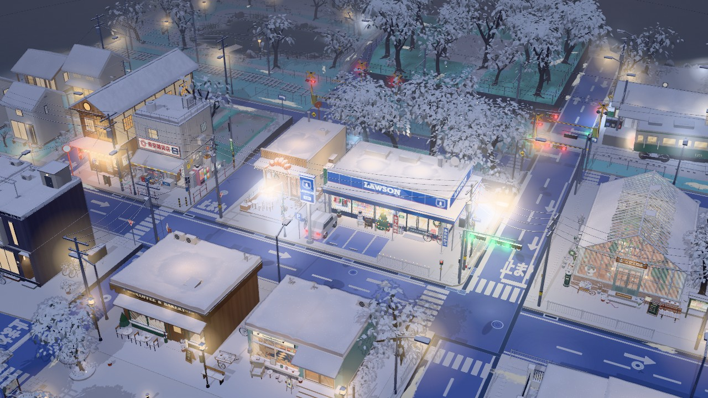
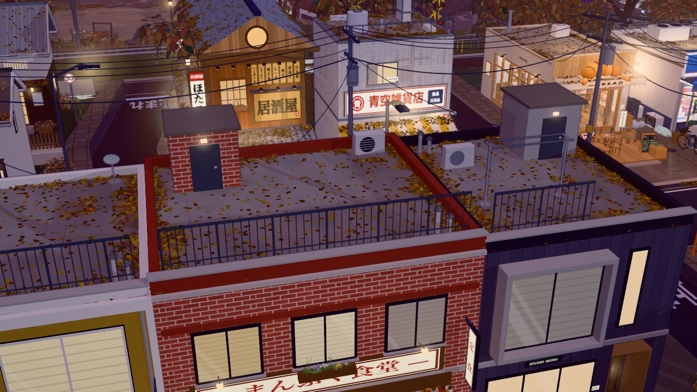
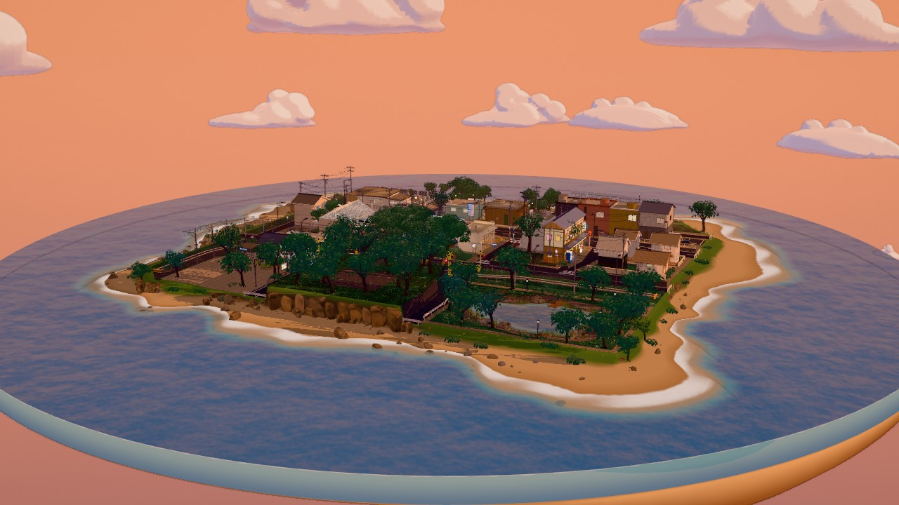

# Konbini Town 3D 🌸

**A cozy Japanese convenience-store town on a floating island, made entirely in code with Three.js.**
It has live weather, four seasons, a full day-night cycle and seasonal festivals. You can rotate, zoom and wander through every street.



There are no downloaded 3D models and no image textures. The buildings, trees, clouds, rocks, signs and the train are all modelled procedurally in JavaScript (~20k lines in 67 modules). Everything builds into **one self-contained HTML file** (~1.6 MB) that runs offline in any modern browser.

---

## Screenshots

| | |
|---|---|
|  |  |
| **The LAWSON corner**: the convenience store the town grew around | **Sakura plaza**: the fountain, a coffee shop and a bookstore |
|  |  |
| **Rainy midnight**: wet streets, reflections and puddle ripples | **Snowy Christmas night**: snow builds up on roofs, trees and streets |
|  |  |
| **Autumn Halloween evening**: fallen leaves drift on the rooftops | **Summer sunset**: anime-style clouds pick up the evening light |

---

## Features

**A small town, built by hand in code**
- A LAWSON store, a bakery, an izakaya (ほたる), an old corner shop (青空雑貨店), a greenhouse florist (しずく花店), a coffee shop, a bookstore, a row of town houses, family homes, a walled villa and a local station (星空町駅) with a tram on its line
- Roads with zebra crossings, signals, curve mirrors, tactile paving and sidewalk fences, all laid out to real Japanese street conventions
- One planned network of overhead power and phone lines; a lake park, a sakura plaza with a fountain, and a shrine wood on a terrace

**Living environment**
- **7 weathers**: sunny, cloudy, rain, heavy rain, snow, fog, thunder
- **4 seasons**: cherry blossom, summer green, autumn colour, bare winter branches
- **24-hour day-night cycle**: sun and moon, golden hour, window and street lights that switch on in the evening
- **Festivals**: sakura festival, summer festival, Halloween, Christmas, New Year (fireworks on festival nights)
- Petals, leaves and snow **pile up** on roofs, awnings and the ground, depending on season and weather
- Stylised, layered **anime clouds** (10+ shapes), tinted by sunset and night light
- Vegetation that sways in the wind and changes with the seasons (grasses, wildflowers, shrubs, potted plants, trees)

**Rendering**
- Toon shading with a custom light ramp, plus a screen-space **outline pass** for the illustrated look
- Wet-ground reflections, a shared water system (lake, sea and shallows), and a rain-ripple layer
- Static batching and instancing to keep thousands of objects fast; adjustable quality levels

---

## Run it

The built file is already in the repo. **Download `rainy-konbini-diorama.html` and open it in a browser.**

To build from source:

```bash
npm install
node build.mjs          # development build
node build.mjs --prod   # minified single-file release
```

**Controls**: drag to rotate · scroll to zoom · right-drag to pan · `H` hides the panel. The ⚙ 环境 (Environment) button opens the weather / season / time / festival controls and presets.

**URL parameters** (handy for sharing a scene):

| Parameter | Example | Meaning |
|---|---|---|
| `w` | `w=snowy` | weather: `sunny` `cloudy` `rainy` `heavy` `snowy` `foggy` `thunder` |
| `s` | `s=autumn` | season: `spring` `summer` `autumn` `winter` |
| `t` | `t=21.5` | time of day (hours) |
| `h` | `h=christmas` | festival: `sakura` `summer` `halloween` `christmas` `newyear` |
| `p` | `p=rainyMidnight` | a preset scene |
| `intro` | `intro=0` | skip the opening camera move |

Example: `rainy-konbini-diorama.html?w=snowy&s=winter&t=21&h=christmas`

---

## Tech

- **Three.js** (WebGL), plain JavaScript ES modules, bundled with **esbuild**
- Everything procedural: geometry built from primitives, extrusions and marching cubes, plus canvas-drawn textures (signs, posters, paving, road markings)
- Custom shaders patched into Three.js toon materials (snow cover, blossom, wind sway, wetness)

```
src/
  main.js          app entry: camera, controls, render loop, URL parameters
  env.js           weather / season / time / festival state and lighting
  post.js          outline + post-processing pipeline
  world.js         builds the scene, static batching
  store.js …       the original LAWSON corner
  town/            the town: layout, roads, buildings, island, station, roadside, plaza …
  plants/          grasses, flowers, shrubs and potted plants
  clouds.js        stylised layered clouds
  roofPiles.js     petals / leaves / snow on roofs; groundPiles.js on the ground
```

---

## 中文简介

**Konbini Town 3D** 是一个用 Three.js 纯代码构建的日式便利店小镇立体模型（diorama），整座小镇建在一座漂浮的小岛上。

- 没有用任何现成的 3D 模型或图片素材：建筑、树木、云朵、岩石、招牌和电车都在代码里程序化建模。约 2 万行 JavaScript，分为 67 个模块，最终打包成一个可以离线打开的 HTML 文件。
- 环境系统：7 种天气、四季变化、24 小时昼夜，还有樱花祭、夏祭、万圣节、圣诞、新年等节日（节日夜晚有烟花）。
- 落花、落叶和积雪会随季节和天气堆积在屋顶与地面上。云朵是层叠的日式动画风格，会随夕阳和夜晚变色。
- 渲染上使用卡通着色和描边后处理，配合湿地反射、水面系统，并做了静态合批与实例化等性能优化。

直接用浏览器打开 `rainy-konbini-diorama.html` 即可体验。
